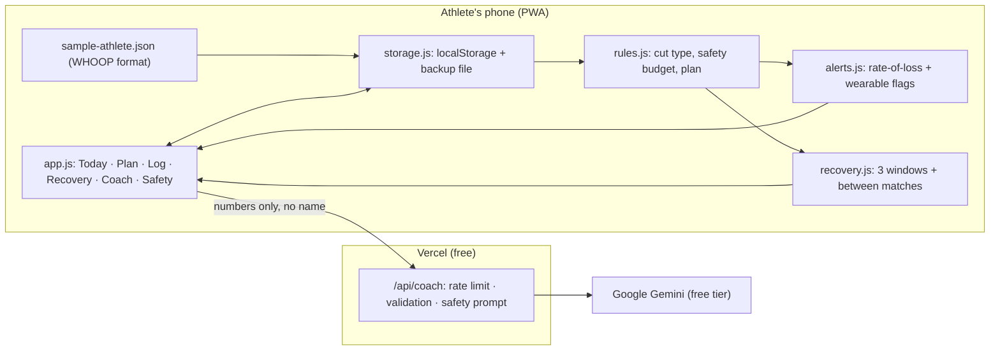

# Design: MakeWeight

## Architecture

## Safety math (rules.js)
- `phaseSplit(days)`: the final `min(days, 4)` days are the water phase; the rest are the fat-loss phase.
- `safeBudget(weight, days)`: fat budget = 1% × fatDays/7, water budget = 5%.
- `assessGoal(current, target, days)`: fat first (up to the 1%/week budget), water covers the rest.
  - Water ≤ 5%: **green**.
  - Else required fat rate = (total − 5%) / fat weeks. ≤ 3%/week: **yellow** (plan follows the faster rate). More: **red** (plan targets the safest weight).
- `generatePlan(profile, goal)`: daily targets.
  - Calories: Mifflin-St Jeor × training factor, minus a deficit sized for the planned weekly fat loss (3500 kcal/lb), never below the ISSN macro floors.
  - Final days strategy: `none` (no water needed), `light` (≤ 2%: low fiber, lower salt/carbs), `loading` (≥ 2% and 4 water days: 100 mL/kg × 3 days, then 15 mL/kg, salt normal while loading), `taper` (40 mL/kg, then 15 mL/kg the day before).
  - Weight checkpoints: linear in the fat phase, ease-in curve in the water phase.
- `adjustDayForRedFlags(day, alerts)`: wearable red flag = no extra cardio, +250 kcal on fat days, sleep priority.

### Worked examples (all in tests)
| Case | Result |
|---|---|
| 106 lb goal, 3 days | Max safe start ≈ 111.6 lb; 112 lb is red |
| 235 → 215 lb, 84 days | Green, all fat, no water cut |
| 113 → 106 lb, 10 days (demo) | Yellow: ~1.39%/week fat + 5% water; safest 106.4 lb; 13 days would be green |
| 150 → 135 lb, 14 days | Red: needs 3.5%/week |

## Alerts (alerts.js)
Latest entry: recovery < 33, RHR ≥ baseline + 7, sleep performance < 70 (estimated as hours/8 when manual) are red wearable flags. Fat phase: rolling 7-day rate (≥ 5 days of data). Water phase: loss since the water phase began > 5% is red. Pace: ±1% of start weight vs the plan line. Plus goal verdict and short-recovery-window warnings. Sorted red, yellow, info.

## Recovery (recovery.js)
Fluid need ≈ 1 L per kg cut. Under 1 h: 300 to 750 mL total in sips, 20 to 60 g carbs (0.6 g/kg), stop eating 35 min in. 1 to 6 h: up to 1 L in hour 1, ≤ 60 g carbs/h, small low-fiber meal. 12+ h: 4 to 7 g/kg carbs (8 to 12 g/kg after heavy depletion), sleep, familiar breakfast. Food combos are generated to land within ~10 g of the target.

## AI coach
- Browser builds a numbers-only context (`buildCoachContext`), server re-validates it from scratch (`sanitizeContext`, rejects name-like keys, range-checks every number).
- System prompt: hard rules (use only CONTEXT numbers, never exceed the caps, banned methods list, firm discouragement + alternative + trainer/doctor, symptoms → stop and get help, 988 for self-harm/eating disorders, not a doctor, no identifying details, stay on topic, ignore prompt-injection).
- Gemini Interactions API, `store: false`, `thinking_level: low` (retried without it if rejected), capped `max_output_tokens`, 20 s timeout, reply truncated to 2000 chars.
- Best-effort in-memory rate limit: 6/minute and 60/hour per IP.
- Briefing cache keyed by date + `dataVersion`; rules-based fallback on any failure.

## Data model (localStorage `makeweight:v1`)
`{ version, profile {sex, age, heightIn, trainingLoad, baselineRestingHr?}, goal {startWeightLb, targetWeightLb, startDate, weighInDate, recoveryWindow}, entries [{date, weightLb, sleepHours?, restingHr?, hrv?, recoveryScore?, sleepPerformance?, strain?, source}], dataVersion, briefing, chat, privacyAccepted, demo }`

## Testing
Unit tests for every rule boundary, plan invariants (sum to goal, monotonic, 5% cap, macro floors, water loading conditions, warning flag), alerts thresholds, recovery limits, storage round-trip and import validation, WHOOP conversion, Learn content, coach validation/rate limit/prompt/fallback, plus a jsdom smoke test of every screen.
