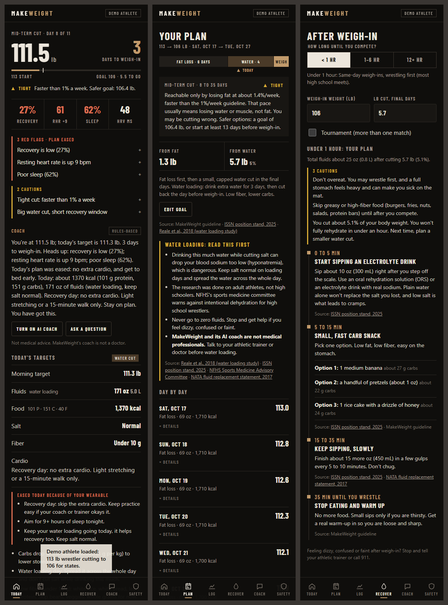
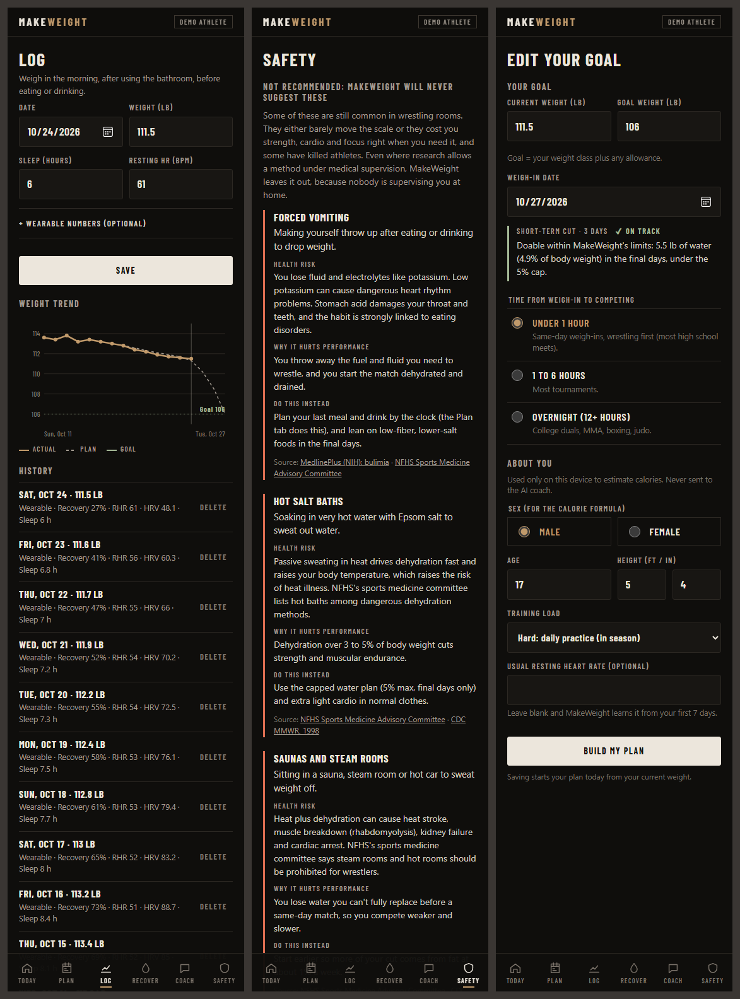

# MakeWeight

**Cut weight safely. Refuel right. Built by a wrestler, for wrestlers.**

MakeWeight is a phone-first web app that helps wrestlers and combat athletes plan a safe weight cut, catch warning signs in their wearable data, and refuel after weigh-ins. It's private by design: the athlete is the only user, so there's no reason to hide or fake numbers.

Hackachusetts 2026 · Healthcare & Biotech track · *Turning wearable data into better healthcare*

**Live app:** https://makeweight-six.vercel.app · **Try the demo athlete:** https://makeweight-six.vercel.app/?demo




## The problem
Weight cutting is part of wrestling, and most athletes learn it from teammates. That's how people end up forcing themselves to vomit, sitting in salt baths and saunas, or skipping all fluids, then overeating right before they wrestle. In 1997, three college wrestlers died from heat and dehydration while rapidly cutting weight. Meanwhile, wearables already track the signals that show a cut going wrong (recovery, resting heart rate, HRV, sleep), but nothing turns them into cut-specific guidance.

## What it does
- **Safe descent planner.** Enter your current weight, your goal weight (typed in, since classes vary by age, sport, state and allowance) and your weigh-in date. MakeWeight picks a short-term (7 days or less), mid-term (8 to 35 days) or long-term (more than 35 days) cut and builds a day-by-day plan: weight checkpoints, calories and macros, fluids, salt, fiber and cardio.
- **One universal set of safety limits.**
  - Fat loss: about 1% of body weight per week. Over 1% is yellow ("you may be cutting wrong"), over 3% is red ("mostly water, not fat").
  - Water cut: capped at 5% of body weight, final days only.
  - If a goal isn't safe in the time left, the app says so, plans to the safest reachable weight, and suggests a higher goal or more time.
- **Wearable red flags.** Recovery under 33%, resting HR 7+ bpm above your baseline, or sleep performance under 70% triggers a red alert and eases that day's plan. Alerts run every time data is saved.
- **Weigh-in recovery.** Pick under 1 hour, 1 to 6 hours or overnight. You get a timed plan for electrolytes, fluids and carbs (shown as real foods like "1 banana + a handful of pretzels"), scaled to your weight and how much you cut, plus a between-match plan for tournaments.
- **AI coach (Google Gemini).** A daily briefing and a chat panel. The rules engine sets every number; the AI only explains. It firmly shuts down unsafe methods and points to an athletic trainer or doctor.
- **"Not recommended" cards.** Forced vomiting, salt baths, saunas and steam rooms, rubber suits, diuretics, laxatives, spitting and skipping all fluids. Each card covers the health risk, why it hurts performance, a safer alternative and a source.
- **Wearable-ready data.** The demo athlete uses the exact field names from the WHOOP developer API (`recovery_score`, `resting_heart_rate`, `hrv_rmssd_milli`, `sleep_performance_percentage`, `strain`). No wearable? Type in weight, sleep and resting HR.

## Safety and privacy design
- All safety numbers live in one file, [`js/limits.js`](js/limits.js), and every rule has unit tests.
- The AI never sets targets. It gets the rules engine's output and a strict system prompt ([`js/coach-shared.js`](js/coach-shared.js)) listing banned methods, warning symptoms, the 988 Lifeline and "not a doctor."
- Data stays on the athlete's device. The coach receives **numbers only**. The server rebuilds the request from scratch, rejects anything that looks like a name, email or school, and range-checks every number.
- `/api/coach` is a public endpoint with no login. It has per-IP rate limits (6/min, 60/hour, best effort), request size caps and capped output. The Gemini key lives only in Vercel environment variables, never in the repo. On the free tier (no billing attached) there's no cost exposure, but Google may use what's sent to improve its products. That's why the app sends numbers only and shows a privacy note first.
- Water loading always comes with a warning: hyponatremia risk, the research was done on adults, NFHS warns against intentional dehydration for high schoolers, and the app is not a medical professional.
- **MakeWeight is not medical advice.** Check your plan with an athletic trainer, school nurse or doctor.

## Sources
- Ricci AA, et al. ISSN position stand: nutrition and weight cut strategies for MMA and other combat sports. *J Int Soc Sports Nutr.* 2025;22(1):2467909. https://doi.org/10.1080/15502783.2025.2467909
- Reale R, et al. The effect of water loading on acute weight loss following fluid restriction in combat sports athletes. *IJSNEM.* 2018;28(6):565-573. https://doi.org/10.1123/ijsnem.2017-0183
- NFHS. Rules in place to guard against weight cutting in wrestling. https://www.nfhs.org/articles/rules-in-place-to-guard-against-weight-cutting-in-wrestling
- CDC. Hyperthermia and dehydration-related deaths in three collegiate wrestlers, 1997. *MMWR.* 1998;47(6):105-108. https://pubmed.ncbi.nlm.nih.gov/9480411/
- McDermott BP, et al. NATA position statement: fluid replacement for the physically active. *J Athl Train.* 2017;52(9):877-895. https://doi.org/10.4085/1062-6050-52.9.02
- MedlinePlus (NIH): Bulimia. https://medlineplus.gov/ency/article/000341.htm
- WHOOP Developer API (OpenAPI spec). https://api.prod.whoop.com/developer/doc/openapi.json

## How Kiro was used
- **Planning first.** About two hours of back-and-forth with Kiro turned a rough idea into scoped requirements: cut types, universal limits tuned from my own wrestling experience, the three recovery windows, the banned-methods list and the privacy model. Kiro researched the track rules, the WHOOP API spec, the ISSN position stand and the water loading study, and pushed back where safety mattered.
- **Spec-driven build.** The plan lives in [`.kiro/specs/makeweight/`](.kiro/specs/makeweight/) (requirements, design and tasks), and Kiro worked through the tasks in order.
- **Steering files.** [`.kiro/steering/product.md`](.kiro/steering/product.md) holds the safety rules, banned methods and coach tone. [`.kiro/steering/tech.md`](.kiro/steering/tech.md) holds the stack and conventions. Every Kiro session follows them.
- **Hooks.** `test-on-save` runs the full test suite on every JS/JSON save. `safety-review` makes Kiro re-check any change to a safety-critical file against the product rules.
- **AI-written tests.** 88 tests (Node's built-in runner) cover every safety boundary, plan invariant, alert threshold, recovery limit, data validation, the coach's validation, rate limit and safety prompt, plus a simulated-browser walkthrough of every screen.
- **Source checking.** Kiro verified every citation before it went into the app and dropped claims it couldn't confirm.

## Run it locally
Requires [Node.js](https://nodejs.org) 20 or newer.

```bash
npm install          # dev tools for tests (jsdom)
npm test             # run all tests
npm run dev          # http://localhost:5173 (site + AI coach API)
```

To use the AI coach locally, copy `.env.example` to `.env` and paste a free Gemini API key from [Google AI Studio](https://aistudio.google.com). `.env` is git-ignored.

## Deploy (Vercel, free)
1. Push this repo to GitHub (public).
2. On [vercel.com](https://vercel.com), sign up with GitHub, then **Add New → Project** and import the repo. No build settings are needed.
3. In **Settings → Environment Variables**, add `GEMINI_API_KEY` (and optionally `GEMINI_MODEL`). Redeploy.

## Install on your phone
- **iPhone (Safari):** Share → Add to Home Screen.
- **Android (Chrome):** menu (⋮) → Install app / Add to Home screen.

## What's next
- A live WHOOP connection (the data model already matches the API).
- Optional Google sign-in with cloud sync.
- Garmin, Apple Health and smart-scale imports.
- Hydration testing (urine color/specific gravity) logging.

## Project layout
```
index.html, css/, js/       the app (no framework, no build step)
api/coach.js                Vercel serverless function for the AI coach
data/                       demo athlete (WHOOP format) + Safety tab content
tests/                      88 tests, run with npm test
fonts/                      Barlow Condensed (self-hosted, SIL Open Font License)
scripts/                    local dev server, demo data and icon generators
.kiro/                      Kiro specs, steering and hooks
```
